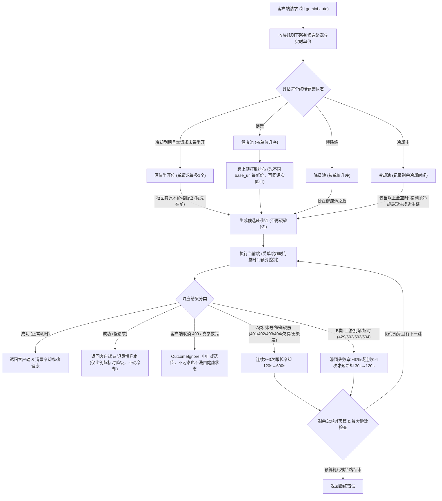

# 智能价格优先分流与异常转移重构方案

日期：2026-11-19  
状态：本地代码实现与全套仿真测试已完成（待确认线上参数后发版部署）

---

## 1. 背景与核心目标

随着接入的中转站与渠道不断增多（后续预计扩展至 **15~30+ 个路由终端**），且同一中转站内往往存在多个不同折扣/定价的分组，需要一套真正**高可用、低成本、成本可精确核算、零人工盯盘**的智能分流与异常转移引擎。

### 核心业务诉求

1. **严格价格优先**：便宜渠道正常时，几乎 100% 流量走最便宜的健康渠道；不浪费高价备用。
2. **成本 100% 确定可核算**：同一中转站的不同价格分组，拆分为独立 Key + 独立 Provider 导入（一渠道一固定单价），彻底消除“单 Key 绑定中转站内部多个不同折扣分组导致成本漂移、利润算不准”的问题，并打破单个中转站内部黑盒，实现**跨平台全局按价混排**。
3. **异常毫秒级无感转移**：任何渠道出现封号、欠费、无可用号池、不支持 JSON mode、限流或超时时，在单笔请求内自动顺延切换，业务端尽量无感。
4. **便宜渠道自动原位复活**：便宜主力从冷却恢复后，必须能第一时间自动切回接管流量，绝不允许因高价备用存在而被永久饿死在冷却态。
5. **海量终端可扩展**：支持数十个渠道同时接入，自动按真实定价排序、防止探针雪崩、避免同源平台故障时连续撞墙。

---

## 2. 现有系统 7 大根因缺陷总结（线上排查实证）

基于 2026-11-12 与 2026-11-19 线上日志与源码交叉排查，现有分组分流存在以下结构性缺陷：

| 编号 | 缺陷现象 | 源码位置 | 实际线上危害 |
|---|---|---|---|
| 1 | **`HalfOpenProbe` 半开“僵尸死锁”** | `plugins/governance/health_tracker.go` (`getTargetRoutingHealth`, `shouldHalfOpenProbeLocked`) + `plugins/governance/grouped_router.go` (`chain[:3]`) | 冷却到期后目标被塞进队尾 `halfOpen` 且不清除 `cooldownUntil`；只要后排有 ≥3 个健康备用，队尾半开目标直接被 `chain[:3]` 裁掉或被前排成功截胡，`resetCooldownLocked` 永不可达。**备用越多，便宜主力越永久无法复活**（实测 `云雾API` 等 4 个通道同时被锁死 15+ 分钟 0 流量）。 |
| 2 | **致命 `4xx` 被误判为 `OutcomeSuccess`** | `plugins/governance/outcome_classifier.go` (`ClassifyOutcome`) | 只扫 `err.Error.Message`、忽略 `Code`/`Type`，且未命中关键词的 `4xx` 全部返回 `OutcomeSuccess`（反而清零失败次数并解除冷却）。导致 `400 credit insufficient balance`（4,730 次）、`404 Requested entity was not found`（209 次）、`403 User has been banned`、`403 You have no active subscription`、`401 Invalid token` 均被当成“100% 健康”，持续黑洞吸流。 |
| 3 | **不看失败率只看绝对次数 + 单次慢请求直接硬冷却** | `plugins/governance/health_tracker.go` (`isDegradedLocked`, `evaluateCooldownLocked`) | ① 高峰 2 分钟内成功 100 笔仅超时 3 笔（97% 成功率）也会命中 `failure_threshold=3` 进 `240s~600s` 长冷却；② 任意 **1 笔** ≥60s 慢成功即触发 `isDegradedLocked=true` 并被 `evaluateCooldownLocked` 直接打入 120s 硬冷却（`HealthDegraded` 实际失效）。 |
| 4 | **同源上游扎堆浪费 Fallback 名额** | `plugins/governance/grouped_router.go` | 当同一上游的多个账号/分组（如 `B.AI`、`B.AI-6fold`、`B.AI-7fold` 同指一个网关）紧挨排布，且该上游整体波动（503/504）时，单笔请求的 2、3 跳会在同一家故障平台上连续撞墙。 |
| 5 | **固定截断 `chain[:3]` 不区分“秒拒”与“慢超时”** | `plugins/governance/grouped_router.go` (`len(chain) > 3`) | 遇到 0.3 秒秒拒（403/503）时还剩 180 秒预算却在第 3 跳后硬放弃；遇到 60 秒超时连踩 2 次已耗时 120 秒却无动态时间预算兜底，容易引发客户端提前断开（`499`）。 |
| 6 | **主动健康探测与路由状态机割裂** | `plugins/governance/active_probe.go` (`applyActiveProbeResult`) | 后台主动探测只更新 UI 展示字段，既不唤醒已恢复的冷却通道，也不辅助熔断死通道。 |
| 7 | **全冷却时直接跳过规则裸奔** | `plugins/governance/routing.go` (`EvaluateRoutingRules`) | 全组同时冷却时 `buildGroupedRoutingDecision` 返回 `nil` 并 `continue` 跳过规则，导致裸别名（如 `gemini-auto`）穿透报错 `model should be in provider/model format`。 |

---

## 3. 多价格分组拆分与成本精确核算模式

### 3.1 推荐的渠道建模原则：**一价一 Key 一 Provider**

当某中转站内部存在多个不同价格/折扣的分组（例如特价分组、普通分组、官转分组、VIP 分组）时：

- **禁止做法**：在对方中转站建 1 把“自动混用 5~6 个不同价格分组”的 Key 接入 Bifrost。
  - 缺点 1：Bifrost 无法得知每次请求实际扣的是哪个折扣档位，导致成本与利润账本（`profit_events`）失真；
  - 缺点 2：中转站内部廉价组失败时，会直接在其黑盒内切到高价组扣费，剥夺了 Bifrost 切去**其他更便宜中转站**的机会。
- **推荐做法**：在中转站后台为每个独立定价的分组分别创建专用 Key，在 Bifrost 中分别配置为独立 Provider（清晰命名，如 `平台A-特价`、`平台A-官转`），并填好各自精确的 `pricing_overrides`（输入 / 输出 / 缓存读取单价）。

### 3.2 拆分后的跨平台全局排序效果

假设接入 3 家平台、拆出 7 个定价明确的渠道，Bifrost 自动按真实单价全局混排：

```text
平台A-特价 ($0.05) → 平台B-特价 ($0.22) → 平台C-普通 ($0.59) → 平台A-6折 ($1.20) → 平台A-7折 ($1.40) → 平台C-VIP ($1.62)
```

- **收益 1（成本绝对透明）**：每笔日志落在哪个 Provider 就严格按该 Provider 的固定单价计费，利润报表 100% 准确。
- **收益 2（全局最优省钱）**：`平台A-特价` 挂了，流量先去 `$0.22` 的 `平台B-特价` 和 `$0.59` 的 `平台C-普通`，不会盲目在平台 A 内部直接跳涨到 `$1.20`。
- **收益 3（极低运维成本）**：后续新增任何渠道或分组，只需填好 Key 与单价丢进路由池，无需人工反复拖动排序。

---

## 4. 新版智能分流与异常转移核心架构（6 大机制）



### 机制 1：4 级精准错误分类（Smart Error Taxonomy）

在分组路由模式下（上游 Provider / Model / Key 均为网关固定配置），同时检查 `HTTP StatusCode`、`err.Error.Code`、`err.Error.Type` 与 `err.Error.Message`：

| 级别 | 类型 | 典型触发条件 | 当前请求行为 | 通道健康与冷却策略 |
|---|---|---|---|---|
| **A 级** | **账号/渠道致命故障 (`OutcomeFatalChannel`)** | `401`（Invalid token）、`402`、`403`（banned / 无订阅 / insufficient_quota / deposit required）、`404`（model/entity not found）、`400` 且 code/message 含 `insufficient` / `balance` / `credit` / `quota` / `billing`、`503` 含 `No available channel` / `没有可用token` / `auth_unavailable` / `fallback_skip_json` | **毫秒级切换下一跳** | **快速熔断 + 长退避**：连续 `2~3` 次即触发冷却 `120s → 240s → 600s`（兼容中转站内部偶发 1 次子号异常，不因单次 403 误杀 96% 可用的超低价站；若真欠费/封号则 2~3 次秒断） |
| **B 级** | **上游瞬时抖动/拥堵 (`OutcomeTransientFail`)** | `504`（请求/流空闲超时）、`429`（限流）、`502`、通用 `503`（temporarily unavailable / overloaded）、连接重置/TLS 超时 | **立即切换下一跳（优先跨上游）** | **看比例不看绝对次数 + 短冷却**：滑窗（最近 `20` 笔，至少 `5` 笔样本）失败率 ≥ `40%`，**或** 连续失败 ≥ `4` 次，才进短冷却 `30s → 60s → 120s`（封顶 `180s`） |
| **C 级** | **慢成功 (`OutcomeSlow`)** | 请求成功但耗时 ≥ `slow_threshold_ms`（如 `45s` 或 `60s`） | 已成功返回 | **只降级，绝不硬冷却**：最近 `10` 笔慢占比 ≥ `50%` 时标为 `degraded`（暂排在健康池之后），`60s` 无新慢样本或恢复快响应即自动回到 `healthy` |
| **D 级** | **客户端行为/真参数错 (`OutcomeIgnore`)** | `499`（`context canceled` / 客户端主动断连）、不含余额/配额关键词的纯 `400` 参数错误 | `499` 中止不重试；真 `400` 按配置返回或透传 | **完全忽略**：既不增加失败计数，也**绝对不重置已有失败计数或解除冷却**（杜绝“坏通道洗白”） |

### 机制 2：原位半开复活 + 防探针雪崩（In-Place Half-Open Probe）

彻底修复“便宜主力一冷却就永久回不来”的死锁问题：

1. **原位试探，不塞队尾**：当某便宜通道冷却到期，进入半开试探时，**直接放回它原本的价格顺位（通常即第 1 跳 Primary）**，其后紧跟健康的次便宜渠道作为兜底。
   - 若这 1 笔成功 → **立刻清零冷却与连续失败次数**，大盘流量 1 秒切回最便宜主力；
   - 若这 1 笔失败 → **该笔请求在网关内无缝 Fallback 到第 2 跳健康渠道救回（客户端无感）**，同时该便宜通道按退避倍数进入下一轮冷却。
2. **防探针雪崩（面向 15~30+ 多渠道场景）**：
   - 每个冷却到期渠道仍维持原子单并发试探锁（同一时刻只放 1 笔请求去探）；
   - **单笔用户请求最多只携带 1 个半开试探目标**（优先选价格最便宜的那个到期目标），该请求的后续 Fallback 槽位必须由已确认健康的通道填补，避免多渠道同时解冻时把 1 笔用户请求变成“连续踩 3 个雷”的牺牲品。
3. **防僵尸锁超时**：在途半开试探若超过单跳超时 + 缓冲（如 `65s`）仍未回写结果（如遇到 `499` 被取消或异常中止），自动释放 `halfOpenInFlight` 锁，永不死锁。
4. **主动探测闭环（已实现并支持规则级防误休眠）**：开启 `active_probe_wakeup: true` 后，只要同规则（如 `gemini-auto`）下仍有真实流量，规则内处于冷却中的便宜渠道不再因单通道超过 `idle_pause`（2 分钟）而暂停探测；一旦后台探测成功，立即将其提前解锁为“允许进入原位半开试探”，同时半夜整条规则无人访问时照常自动休眠省探测费。

### 机制 3：同源上游打散（Upstream Diversity）与精准故障隔离

针对「同一中转站拆成多个独立定价 Provider（共用同一个 `base_url`）」的场景：

1. **健康与冷却粒度严格到单终端（`provider:model:key_id`）**：
   - 平台 A 的“特价分组”因 `No available channel` 或余额不足被熔断，**绝不会牵连**平台 A 的“6 折官转分组”，后者按价格顺位正常待命。
2. **单笔请求内的 Fallback 链路执行“跨上游优先打散”**：
   - 提取每个候选 Provider 的上游主机标识（如 `base_url` 的 host，或可选手工配置 `upstream_group` 标签）；
   - 构造单笔请求的候选链时，执行**分轮按价排布**：
     - **第一轮（跨故障域覆盖）**：按价格从低到高，每个独立上游先选出它最便宜的 **1 个健康终端**（例如：`NightRouter($0.05)` → `云雾($0.22)` → `poloapi($0.59)` → `B.AI($0.80)`）；
     - **第二轮（同源梯队替补）**：将同上游的其他更高价位健康终端按价格从低到高追加在后（例如：`B.AI-6fold($1.20)` → `B.AI-7fold($1.40)` → `poloapi_vip($1.62)`）；
   - **动态效果**：
     - 当 `B.AI($0.80)` 自身因欠费进冷却后，`B.AI-6fold($1.20)` 自动晋升为 `bai.zdfan.com` 的最便宜健康代表进入第一轮；
     - 当 `bai.zdfan.com` 整体抽风（503/504）时，单笔请求打完 `B.AI` 后下一跳会先去别的独立平台，不会在同一笔请求里连撞 3 个 `B.AI` 账号。

### 机制 4：动态时间预算（Deadline Budget）+ 阶梯单跳超时

用**时间预算**取代写死的 `chain[:3]`：

1. **总切换预算控制**：
   - 在路由规则 `health_policy` 中支持配置 `max_fallback_attempts`（默认如 `5`~`6`）与 `fallback_budget_ms`（如 `135000`ms，为调用方 `190s` 留足安全余量）；
   - 在 `core/bifrost.go` 执行下一次 Fallback 前判断：`当前已耗时 < fallback_budget_ms` 且 `已尝试次数 < max_fallback_attempts`：
     - **遇到快速失败（`403`/`503`/`429` 耗时 0.3s）**：剩余预算充裕，可顺滑连续试 4~6 个独立渠道，大幅拉升成功率；
     - **遇到慢超时（45s~60s）**：一旦剩余预算不足以再撑一跳，及时止损返回，避免拖穿客户端超时引发大面积 `499`。
2. **阶梯单跳超时（渠道维度配置）**：
   - 前排超低价中转站（均耗时 10~17s）：建议将 `default_request_timeout_in_seconds` 调至 **`45s`**（卡死早 15 秒止损切下一跳）；
   - 后排高价稳健保底渠道：保留 **`60s`**，给足复杂长上下文生成窗口。

### 机制 5：单池自动按价排序（兼容多组手工分层）

针对未来 15~30+ 渠道接入的易用性：

- 增强 `selectCostAwareResolvedTargets`：
  - 当一个 Group 中放入多个不同价格的终端且开启按价排序模式（或未限制 `slots` 截断）时，**允许从该 Group 依次产出全部健康终端（按 `pricing_overrides` 真实成本升序）**，而不再受 `retry_limit=0` 只取 1 个的限制；
  - **双向兼容**：既可以只建 1~2 个大池子（如「主力按价池」+「高价兜底池」）把所有拆分好单价的渠道直接丢进去自动排班，也可以继续保留“每档一个 Group”的手工编排习惯。

### 机制 6：全冷却保底逃生（All-Cooldown Graceful Degradation）

- 当规则下**所有候选终端**同时处于冷却态时，`buildGroupedRoutingDecision` **不再返回 `nil` 跳过规则**；
- 改为启动**逃生链构建**：优先选「非致命失败（B 类拥堵）> 致命失败（A 类欠费/封号）」，同级内按「剩余冷却时间最短」且「跨上游优先」选出应急候选链尝试请求，彻底消除裸 `gemini-auto` 穿透报错 `model should be in provider/model format`。

---

## 5. 推荐参数基线（`gemini-auto`）

| 参数项 | 旧线上值 | 建议新值 | 说明 |
|---|---:|---:|---|
| `fatal_consecutive_failures`（新增） | 无（误判成功） | `2`（或 `3`） | A 类硬伤（封号/欠费/无号池/404）连败即快速熔断 |
| `fatal_cooldown_seconds`（新增） | 无 | `120`（上限 `600`） | 死账号/欠费长冷却，少打扰 |
| `consecutive_failures`（B 类） | `2` | `4` | B 类超时/限流连败 4 次才冷却，防高并发误杀 |
| `error_rate_window_size`（新增） | 无（固定 3 次/120s） | `20`（最小样本 `5`） | 看失败比例而非绝对次数 |
| `error_rate_threshold`（新增） | 无 | `0.4`（40%） | 近 20 笔失败率 ≥ 40% 触发短冷却 |
| `cooldown_seconds`（B 类） | `120` | `45`（或 `30`） | 短冷却，主力恢复快 |
| `soft_cooldown_multiplier` | `2`（直接翻倍 240s） | `1` | 不对超时/限流做翻倍惩罚 |
| `cooldown_backoff_factor` | `1.5` | `1.5` | 持续异常时逐步退避 |
| `cooldown_max_seconds`（B 类） | `600` | `180` | 拥堵类冷却封顶 3 分钟 |
| `slow_threshold_ms` | `60000` | `45000` 或 `60000` | 超过算慢样本（仅降级不硬冷） |
| `slow_window_size` / `slow_ratio_threshold` | `5` / `0.6` | `10` / `0.5` | 近 10 笔慢占比 ≥ 50% 才降级 |
| `half_open_probe` | `true`（有死锁） | `true`（原位试探版） | 单请求最多带 1 个原位半开试探 |
| `fallback_budget_ms`（新增） | 无（硬砍 3 次） | `135000` | 单请求总切换预算（适配 190s 调用方上限） |
| `max_fallback_attempts`（新增） | 硬编码 `3` | `5`（或 `6`） | 快速失败时最多可尝试 5~6 个渠道 |

---

## 6. 预期涉及的代码模块（供后续实施对照）

- `framework/configstore/tables/routing.go`：`HealthPolicy` 扩展字段（均向后兼容，旧 JSON 自动走默认值）。
- `plugins/governance/outcome_classifier.go`：实现 4 级错误分类（同时解析 `StatusCode` / `Code` / `Type` / `Message`，区分 `OutcomeFatalChannel` / `OutcomeTransientFail` / `OutcomeSlow` / `OutcomeIgnore`）。
- `plugins/governance/health_tracker.go`：
  - 滑窗失败率判定 + 分级冷却（A 类长冷却、B 类短冷却）；
  - `OutcomeIgnore` 不重置状态；
  - `OutcomeSlow` 只触发 `HealthDegraded` 不触发硬冷却；
  - 修复 `HalfOpenProbe` 原位试探、单并发原子锁与超时自释放。
- `plugins/governance/grouped_router.go`：
  - 半开目标插回原价格顺位 + 单请求最多 1 个半开试探；
  - 同源上游（`base_url`）跨故障域打散排布；
  - 单组按价自动全量出队支持；
  - 移除硬编码 `gemini-auto` `chain[:3]`，改用规则级 `max_fallback_attempts` 与时间预算；
  - 全冷却逃生链构建（不再返回 `nil`）。
- `core/bifrost.go`：Fallback 循环支持 `fallback_budget_ms` 动态剩余耗时检查。
- `plugins/governance/active_probe.go`（可选）：探测成功可提前唤醒冷却目标进入原位半开。
- 单元测试与仿真压测：`outcome_classifier_test.go`、`health_tracker_test.go`、`routing_test.go`、`generation_budget_simulation_test.go`、`adaptive_health_simulation_test.go`。

---

## 7. 待你确认的剩余细节（落地前核对清单）

- [ ] **分组模式偏好**：更倾向「把所有拆分好单价的渠道丢进 1~2 个自动按价排序池」，还是继续「每个价位手工建 1 个 Group」？（推荐代码同时兼容，默认开启同组按价自动出队。）
- [ ] **同源上游判断方式**：按 Provider 的 `base_url` 域名自动归类是否够用？对于“同域名但内部完全独立的不同上游池”（如某些大中转站的普通池 vs 官转 VIP 池），是否需要允许在单笔 Fallback 中仅做“优先跨域名、但不禁止同域名后续替补”？（当前第 3 节方案默认就是“先跨域名、再回落同域名次低价”，已天然兼顾。）
- [ ] **单跳超时调整**：前排超低价中转站是否调为 `45s`，后排稳健保底维持 `60s`？
- [ ] **主动健康探测**：是否让后台主动探测成功直接加速唤醒冷却中的便宜主力，还是先保持纯被动原位半开试探（最省探测费）？
- [ ] **利润计费校对**：拆分为“一价一 Key 一 Provider”后，需逐一核对各 Provider 的 `pricing_overrides`（含 `cache_read_input_token_cost` 及超 128k/200k 分段价，如适用），确保与实际账单一致。
